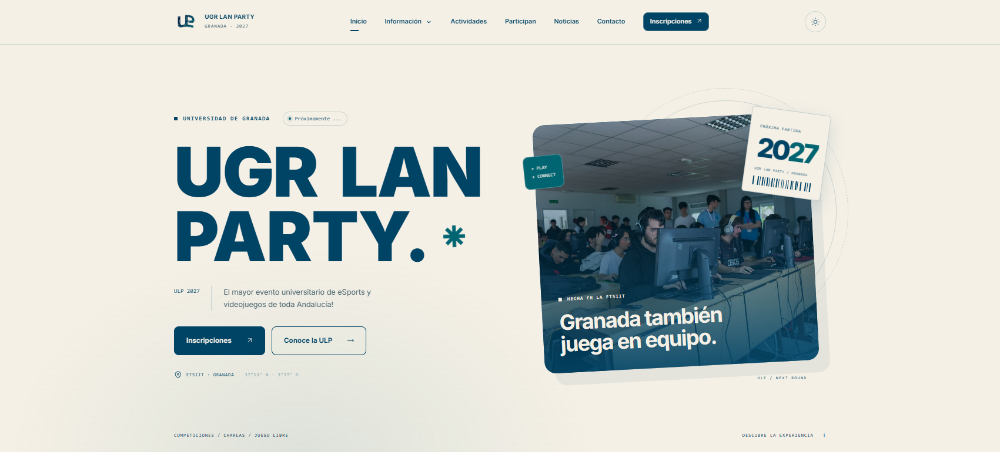

<p align="center">
  
</p>

# ULP Website

Página web oficial de la UGR LAN Party.

## Instalación para desarrollo

La web está construida con Astro y utiliza Node.js y pnpm. El único lockfile es `pnpm-lock.yaml`.

1. Instala la versión de Node.js indicada en `.nvmrc` y la de pnpm fijada en `package.json`.
2. Ejecuta `npm install --global pnpm`.
3. Instala con `pnpm install --frozen-lockfile`.
4. Ejecuta `pnpm dev` y abre la dirección que muestra Astro.

Antes de enviar cambios: `pnpm test` y `pnpm build`. Para regenerar imágenes: `pnpm images`; confirma sus variantes y el manifiesto. Consulta [imágenes](docs/imagenes.md). Las versiones y los parches de dependencias se mantienen en `package.json` y `pnpm-lock.yaml`; `pnpm audit:security` comprueba los avisos de seguridad y el parche incluido.

No generes un segundo lockfile con npm.

## Producción con Docker

1. Primero, en tu entorno de desarrollo, construye la imagen de Docker:

```bash
   docker build -t ulp-website:latest .

```

2. El contenedor generado es completamente autocontenido y usa un servidor de Nginx para servir los archivos, por tanto sólo queda ejecutar el contenedor:

```bash
   docker run -d -p 8080:80 ulp-website:latest
```

La identificación de versiones, las comprobaciones y la vuelta atrás se describen en [despliegue](docs/despliegue.md).

## Créditos de fotografías

Las galerías de Flickr enlazan los álbumes y las fotografías originales de [Rotograber](https://www.flickr.com/photos/rotograber/). Las imágenes locales de colaboradores de 2024 y 2025 proceden de sus fotos [53634340507](https://www.flickr.com/photos/rotograber/53634340507/), [54744242270](https://www.flickr.com/photos/rotograber/54744242270/) y [54744182373](https://www.flickr.com/photos/rotograber/54744182373/). La imagen de colaboradores de 2026 fue facilitada por la organización. La miniatura de Twitch es un fotograma de la [retransmisión de ULP 2026](https://www.twitch.tv/videos/2729691781). Las licencias de recursos de terceros se conservan en `docs/licencias`.
