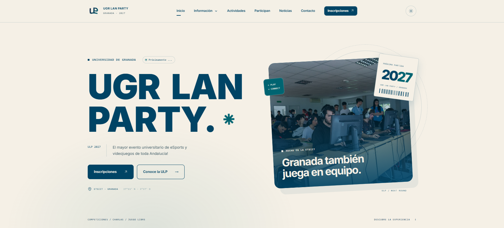

<p align="center">
  
</p>

# ULP Website

[Página web oficial de la UGR LAN Party](https://ulp.ugr.es)


[Performance](https://googlechrome.github.io/lighthouse/viewer/?gist=521d3ce3747c754c1b80dcae048bf21f)


## Instalación para desarrollo

La web está construida con Astro y utiliza Node.js y pnpm. El único lockfile es `pnpm-lock.yaml`.

1. Instala Node.js.
2. Ejecuta `npm install --global pnpm`.
3. Instala con `pnpm install --frozen-lockfile`.
4. Ejecuta `pnpm dev` y abre la dirección que muestra Astro.

Antes de enviar cambios: `pnpm test` y `pnpm build`. Para regenerar imágenes: `pnpm images`; confirma sus variantes y el manifiesto. Consulta [imágenes](docs/imagenes.md) y [dependencias](docs/dependencias.md).

No generes un segundo lockfile con npm.

## Producción con Docker

1. Primero, en tu entorno de desarrollo, construye la imagen de Docker:

```bash
   docker build -t ulp-website:latest .

```

2. El contenedor generado es completamente autocontenido y usa un servidor de Nginx para servir los archivos, por tanto sólo queda ejecutar el contenedor:

```bash
   docker run -d -p 8080:80 ulp-website:latest
```

La identificación de versiones, las comprobaciones y la vuelta atrás se describen en [despliegue](docs/despliegue.md).
